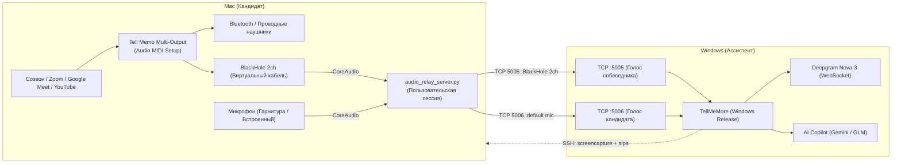

# 🎙️ Двухстанционный режим (Dual-Station Relay): macOS ➔ Windows

Руководство по настройке и запуску совместного режима работы:
- **Mac (Кандидат):** проходит собеседование в наушниках, говорит в микрофон, смотрит экран и слышит собеседника.
- **Windows (Ассистент / Напарник):** находится в соседней комнате (или за вторым монитором), в реальном времени видит транскрипцию речи обоих участников, делает удалённые скриншоты экрана Mac (Alt+2 / Alt+3) и получает подсказки от LLM (Gemini, GLM, OpenAI, Claude).

---

## 🏗️ Архитектура системы



---

## ⚡ Быстрый старт (Чек-лист перед собеседованием)

### На Маке (30 секунд)
1. **Подключите наушники** (например, Redmi Buds или AirPods).
2. **Проверьте системный звук** (в строке меню macOS):
   - **Выход:** `Tell Memo Multi-Output` (звук пойдёт одновременно в ваши наушники и в BlackHole).
   - **Вход:** Ваши наушники или встроенный микрофон.
3. **Запустите аудио-ретранслятор в терминале**:
   ```bash
   nohup python3 /Users/vanmac/sobes123/audio_relay_server.py > /tmp/relay_user.log 2>&1 &
   ```
   *Проверить, что порты открыты:*
   ```bash
   lsof -i :5005 -i :5006
   ```

### На Windows-ноутбуке (15 секунд)
1. Запустите ярлык **TellMeMore** с рабочего стола.
2. Откройте **Настройки (шестерёнка)**:
   - Вкладка **Сеть / Хост**: убедитесь, что указан IP Мака (например, `192.168.1.50`) и SSH-пользователь `vanmac`.
   - Вкладка **Звук**:
     - *Ваш голос:* `Микрофон с Mac (по SSH)`
     - *Голос собеседника:* `Звук с Mac (BlackHole по SSH)`
3. Нажмите **Старт (микрофон)**. Всё готово!

---

## ⚙️ Детальная настройка компонентов

### 1. Настройка звука на macOS («Настройка Audio-MIDI»)
Для разделения звука без задержки используется виртуальный драйвер **BlackHole 2ch**:
1. Откройте встроенное приложение **Настройка Audio-MIDI** (`Audio MIDI Setup.app`).
2. В левом нижнем углу нажмите **«+»** ➔ **«Создать многовыходное устройство»**.
3. Назовите его `Tell Memo Multi-Output`.
4. Отметьте галочками:
   - Ваши **наушники** (сделайте их «Основным устройством» / Master Device).
   - **BlackHole 2ch** (отметьте чекбокс *«Коррекция смещения»* / Drift Correction).

> [!IMPORTANT]
> Причина, по которой важна «Коррекция смещения» (Drift Correction): Bluetooth-гарнитуры обычно работают на частоте `44 100 Гц`, а виртуальный драйвер BlackHole — на `48 000 Гц`. Включение коррекции смещения предотвращает рассинхронизацию тактовых генераторов и потерю аудиокадров.

---

### 2. Сервер ретрансляции ([audio_relay_server.py](file:///Users/vanmac/sobes123/audio_relay_server.py))

Скрипт перенаправляет аудиопотоки с Мака на Windows по прямому локальному TCP-соединению:
- **Порт 5005:** Системный звук собеседника (`BlackHole 2ch`) с автоматическим усилением громкости `volume=2.0`.
- **Порт 5006:** Микрофон кандидата (`:default` — текущий активный микрофон macOS).

#### Ключевые технические особенности скрипта:
- **`os.read(fd, 4096)`**: Прямое чтение из файлового дескриптора без промежуточных буферов Python.
- **`TCP_NODELAY`**: Отключение алгоритма Нейгла для мгновенной доставки 100-мс PCM-пакетов без ожидания сетевых ACK.
- **`-thread_queue_size 2048`**: Буфер входного потока `avfoundation`, исключающий дроп фреймов при высокой нагрузке CPU.
- **`stderr=subprocess.DEVNULL`**: Исключает блокировку системного pipe при генерации предупреждений драйверов.

#### Запуск / Перезапуск / Остановка:
```bash
# Запуск в фоне:
nohup python3 /Users/vanmac/sobes123/audio_relay_server.py > /tmp/relay_user.log 2>&1 &

# Проверка активности:
ps aux | grep audio_relay_server

# Остановка сервера:
pkill -f "python.*audio_relay_server.py"
```

> [!CAUTION]
> **Почему сервер должен запускаться в пользовательской сессии (Aqua), а не через launchd / SSH-демон?**  
> Подсистема безопасности macOS (TCC — Transparency, Consent, and Control) блокирует доступ к микрофону и аудиокабелям процессам, запущенным вне графической сессии пользователя (`sshd` или фоновые LaunchDaemons). При такой блокировке система не выдаёт ошибку, а бесшумно заполняет буфер цифровой тишиной (`-91.0 dB` / нули). Запуск из пользовательского терминала наследует выданные Терминалу разрешения TCC.

---

### 3. Удалённый захват экрана по SSH (Скриншоты)

Когда ассистент на Windows нажимает **Alt+2** (быстрый скриншот + вопрос) или закрепляет экраны в каретку через **Alt+3**:
1. Приложение на Windows выполняет команду по SSH:
   ```bash
   screencapture -x -C /tmp/sobes_screen.png && sips -Z 1536 /tmp/sobes_screen.png --out /tmp/sobes_screen.jpg
   ```
2. Снимок экрана Мака пропорционально сжимается до максимальной стороны `1536px` в формате JPEG.
3. Вес файла уменьшается с ~10 МБ Retina PNG до **~200–280 КБ**, что обеспечивает моментальную передачу по сети и мгновенную отправку в Vision-API моделей.

---

## 🛠️ Устранение возможных неполадок (Troubleshooting)

| Симптом | Причина | Решение |
| :--- | :--- | :--- |
| На Windows тишина собеседника, текст не печатается | Не запущен `audio_relay_server.py` на Маке | Запустите команду `nohup python3 .../audio_relay_server.py &` в терминале Мака |
| Звук прерывается или отстаёт | Включён фоновый VPN между ноутбуками в локальной сети | Убедитесь, что Windows подключается к локальному IP Мака напрямую (например, `192.168.1.x`), а не через медленный туннель |
| Кандидат не слышит звук видео/собеседника | В macOS выбран только `BlackHole 2ch` вместо Multi-Output | В строке меню macOS в списке аудиовыходов переключитесь на `Tell Memo Multi-Output` |
| Ошибка подключения по SSH при скриншотах | Изменился локальный IP-адрес Мака | Проверьте IP Мака (`ifconfig \| grep "inet "`) и укажите актуальный в настройках Windows |

---

## 📦 Расположение бинарников и файлов проекта

- **Сервер ретрансляции:** [`/Users/vanmac/sobes123/audio_relay_server.py`](file:///Users/vanmac/sobes123/audio_relay_server.py)
- **Локальный аудиоконтроллер Flutter:** [`lib/services/audio_controller.dart`](file:///Users/vanmac/sobes123/lib/services/audio_controller.dart)
- **Конфигурационный файл Mac:** `~/.sobes_helper.json`
- **Конфигурационный файл Windows:** `C:\Users\s3rf\.sobes_helper.json`
- **Готовый бинарник macOS:** `/Users/vanmac/sobes123/build/macos/Build/Products/Release/TellMeMore.app`
- **Готовый бинарник Windows:** `C:\Users\s3rf\tellmemore\build\windows\x64\runner\Release\tellmemore.exe`
