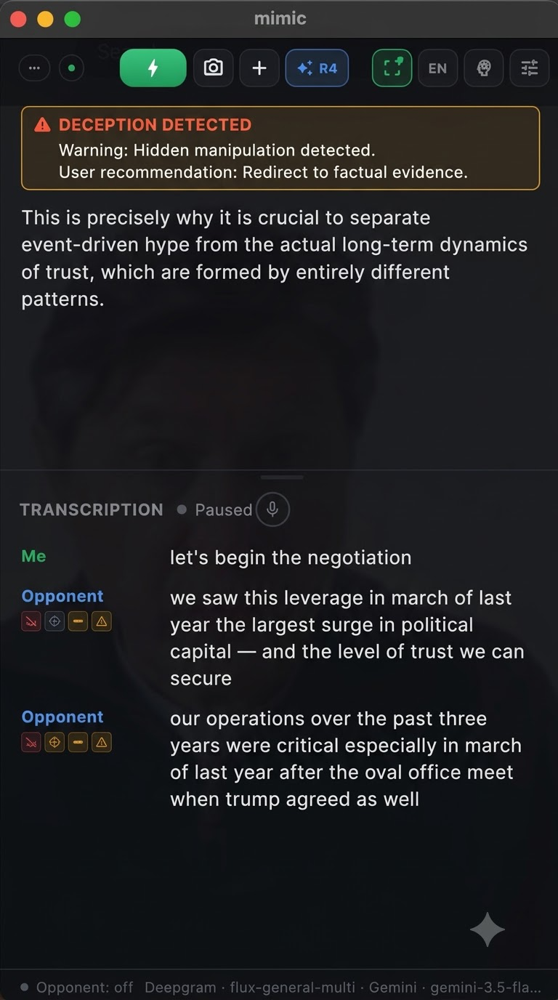
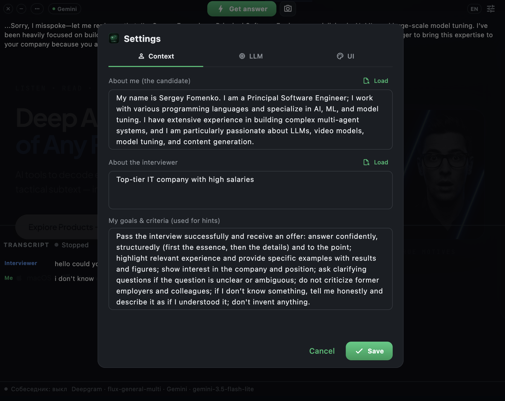
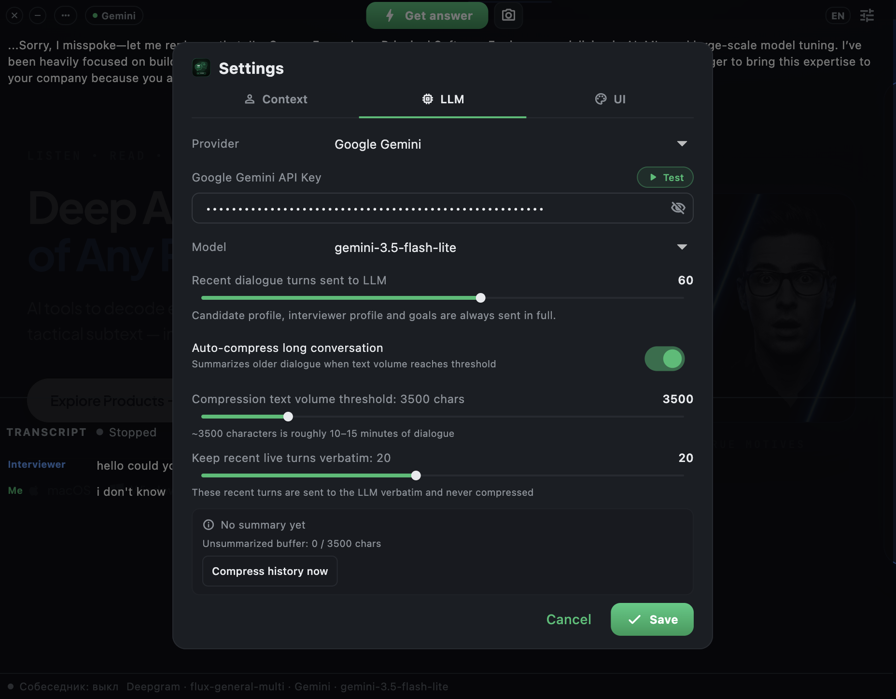
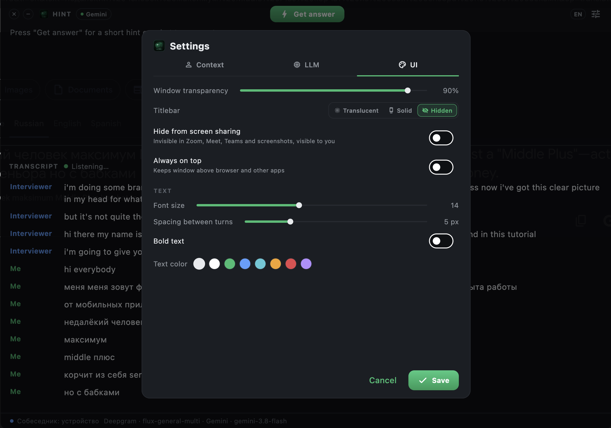

# TellMeMore — Real-Time AI Negotiation & Meeting Intelligence Copilot

<p align="center">
  <a href="README.md"><b>English</b></a> • <a href="README_RU.md"><b>Русский</b></a>
</p>

<p align="center">
  
</p>

<p align="center">
  <strong>An intelligent, non-intrusive floating HUD and real-time copilot for high-stakes business negotiations, client calls, and technical consultations on macOS.</strong><br>
  Dual-stream live speech-to-text, multi-screenshot visual inspection, zero-latency tactical cues, presenter privacy mode, and multi-LLM orchestration.
</p>

<p align="center">
  <a href="https://github.com/s3rfdev/TellMeMore/releases"></a>
  
  
  
  
  
  <a href="LICENSE"></a>
</p>

---

## Why TellMeMore?

High-stakes calls — whether commercial negotiations, architecture reviews, enterprise sales, or executive meetings — demand razor-sharp focus. Leaders and senior engineers must process complex arguments, recall exact technical specs or commercial terms, and counter manipulation tactics on the fly. Traditional notes on secondary monitors disrupt eye contact with the camera and break rapport.

**TellMeMore** acts as your augmented intelligence co-pilot:
1. **Listens in real time:** Captures both your microphone and your counterpart's voice via isolated, independent audio streams.
2. **Maintains a chronological live transcript:** Accurately separates speakers in real time ("Me" vs. "Opponent / Counterpart").
3. **Decodes real-time non-verbal & facial micro-cues:** Native on-device Apple Vision Framework tracks 76 facial landmarks, detecting FACS micro-reactions (AU4 brow furrow, AU24 lip compression, AU14 smirk), eye gaze aversion, blink rate stress spikes, and head pose leakage (e.g., shaking 'no' while verbally agreeing).
4. **Delivers dual Chain-of-Thought tactical guidance (`⌥ 1` / `Get answer`):** Instantly displays a high-contrast tactical psychological alert card (`<dossier>`, e.g., manipulation/deception warnings) alongside calibrated, first-person spoken arguments (`<speech>`).
5. **Inspects multi-screenshot visual context (`⌥ 2`):** Instantly captures one or multiple screenshots of diagrams, slide decks, competitor offers, or code on screen, feeding multi-modal LLMs for immediate situational analysis.
6. **Guarantees Presenter Privacy (`NSWindow.SharingType.none`):** When you share your screen to present slides, software demos, or financial models in Zoom, Google Meet, Microsoft Teams, or Slack, TellMeMore's floating HUD and private strategic notes remain completely invisible to attendees and video recordings.

---

## Screenshots

<div align="center">
  <table>
    <tr>
      <td width="50%">
        <br />
        <b>1. Live Dialogue, Non-Verbal Cues & Tactical HUD</b><br />
        <i>Real-time dual-stream transcription, Apple Vision facial micro-cues, automated deception/manipulation detection banner, and calibrated first-person responses.</i>
      </td>
      <td width="50%">
        <br />
        <b>2. Tailored Profile & Strategic Call Goals</b><br />
        <i>Custom background profile, counterpart/client dossier notes, and defined strategic objectives for calibrated advice.</i>
      </td>
    </tr>
    <tr>
      <td width="50%">
        <br />
        <b>3. Multi-LLM Engine & Context Compression</b><br />
        <i>Google Gemini, Claude, GPT, and GLM integration with sliding window history and automatic memory compression.</i>
      </td>
      <td width="50%">
        <br />
        <b>4. Presenter Privacy & HUD Customization</b><br />
        <i>Screen-share isolation mode, per-pixel opacity slider (0–100%), global hotkeys (⌥1 / ⌥2), and custom typography.</i>
      </td>
    </tr>
  </table>
</div>

---

## Key Features

- **Real-Time Non-Verbal & Facial Micro-Expression Intelligence:**
  - **100% On-Device & Zero Latency:** Built directly on macOS native Apple Vision Framework (`VNDetectFaceLandmarksRequest` with 76 2D points). Runs locally on Apple Silicon (M1/M2/M3/M4) and Intel with no external C++ dependencies and zero cloud telemetry.
  - **FACS & Micro-Cue Analysis:** Monitors AU4 (brow furrow / skepticism), AU24 (lip compression / suppressed stress), AU14 (unilateral smirk / asymmetry), Eye Aspect Ratio (EAR blink frequency and eye blocking >350ms), pupil gaze offset, and head pose (pitch/yaw/roll leakage).
  - **3-Level Temporal Filtering & Behavioral Clustering:** Filters raw camera/screen crop signals through a dynamic exponential moving average baseline (EMA $\alpha=0.01$) to group transient micro-events into behavioral patterns: *Suppressed Stress*, *Skepticism*, *Cognitive Search*, and *False Agreement*. For technical architecture details, see [NONVERBAL_AI_ARCHITECTURE.md](NONVERBAL_AI_ARCHITECTURE.md).
  - **Dual Chain-of-Thought (CoT) Output:** Generates a real-time psychological dossier (`<dossier>`) with alert badges (e.g. `⚠️ DECEPTION DETECTED`) paired with natural, first-person spoken replies (`<speech>`).
  - **Vector HUD Micro-Badges:** Minimalist, unobtrusive SVG indicators with instant hover tooltips positioned directly beneath counterpart turns without cluttering the transcription view.
- **Dual-Stream Audio Isolation (100% Speaker Separation):**
  - Your voice is captured directly from your hardware microphone.
  - The counterpart's voice is captured via [BlackHole](https://existential.audio/blackhole/) (a lightweight, open-source macOS virtual audio driver).
  - Both streams are processed simultaneously via Deepgram Nova-3 WebSocket connections. Zero crosstalk, zero acoustic feedback, zero hallucinated speaker labels.
- **Strict Chronological Dialogue Interleaving:**
  - Sentences are timestamped and segmented on natural grammatical boundaries (`.`, `!`, `?`, or length thresholds).
  - Even during rapid back-and-forth arguments or long monologues, turns are rendered in chronological timeline order.
- **Presenter Privacy Protection (Zero Screen-Share Leak):**
  - Integrated macOS native `NSWindow.SharingType.none`.
  - The window is excluded at the window-server level from desktop captures, window shares, and screenshot tools (Zoom, Google Meet, Teams, Slack, OBS).
- **Multi-Screenshot Visual Analysis (`⌥ 2`):**
  - Quickly capture single or multiple screenshots of the active workspace, client presentation, architecture diagram, or code editor.
  - Multi-modal vision models analyze images alongside the active audio transcript to provide actionable, holistic insights.
- **Floating Translucent HUD Overlay:**
  - True per-pixel transparency (0–100%) so you can read tactical cues while maintaining direct eye contact with your camera.
  - Hidden / translucent / solid titlebar modes with custom window dragging areas.
  - Optional `Always on Top` floating window level.
  - Draggable split-ratio handle between prompt advice and transcript stack.
  - Customizable typography (font size from 6px to 24px, bold toggle, turn spacing, color presets).
- **Multi-LLM Provider Engine:**
  - **Google Gemini** (Gemini 2.5 Flash, 3.8 Flash, Pro, custom models).
  - **Anthropic Claude** (Claude 3.7 Sonnet, Haiku, Opus).
  - **OpenAI** (GPT-4o, GPT-4o-mini, o3-mini).
  - **Z.ai / Zhipu GLM** (GLM-4.7-Flash, GLM-4.5-Flash).
  - Live model latency and availability tester directly inside the settings modal.
- **Intelligent Context Compression:**
  - Configurable dialogue memory window (from 5 to 100 turns).
  - Automatic compression: upon reaching character thresholds (e.g., 3,500 characters), earlier turns are summarized into dense situational memory while recent turns remain verbatim.
  - Your background profile, counterpart dossier, and strategic call goals are **always attached in full** to every LLM request.

---

## Quick Start (Installation)

### Option 1: Download Prebuilt App (Recommended)

1. Download the latest `TellMeMore-macOS.zip` from [Releases](https://github.com/s3rfdev/TellMeMore/releases).
2. Extract the archive and drag `TellMeMore.app` to your `/Applications` folder.
3. Open `TellMeMore.app`. If macOS blocks execution because of Gatekeeper:
   ```bash
   xattr -cr /Applications/TellMeMore.app
   ```

### Option 2: Build from Source

#### Prerequisites
- macOS 13+ (Ventura, Sonoma, Sequoia)
- [Flutter 3.29+](https://flutter.dev) (or via [FVM](https://fvm.app))
- Xcode with Command Line Tools
- [Homebrew](https://brew.sh)

```bash
# 1. Clone the repository
git clone https://github.com/s3rfdev/TellMeMore.git
cd TellMeMore

# 2. Install dependencies
flutter pub get

# 3. Build release bundle
flutter build macos --release

# 4. Launch the application
open build/macos/Build/Products/Release/TellMeMore.app
```

---

## Audio Setup (2-Minute One-Time Configuration)

To capture the counterpart's voice without sending feedback through your microphone, we recommend using **BlackHole 2ch**:

1. **Install BlackHole**:
   ```bash
   brew install --cask blackhole-2ch
   ```
2. **Create a Multi-Output Device**:
   - Open **Audio MIDI Setup** on macOS (press `Cmd + Space` and search for `Audio MIDI Setup`).
   - Click the **`+`** icon in the bottom-left corner and select **Create Multi-Output Device**.
   - Check **your headphones/speakers** AND **BlackHole 2ch**.
   - Keep your headphones at the top of the list as the primary output device (Drift Correction enabled on BlackHole).
3. **Configure Your Call (Zoom / Google Meet / Teams / Browser)**:
   - In your meeting app or macOS sound settings, set **Output / Speaker** to the new **Multi-Output Device**.
   - Set **Input / Microphone** to your real hardware microphone.
4. **Configure TellMeMore**:
   - Open TellMeMore **Settings (⚙) -> LLM -> AUDIO**:
     - **Your microphone:** `System default` (or your headset mic).
     - **Counterpart voice:** `BlackHole 2ch`.

Now, when your counterpart speaks, you hear them clearly in your headphones, and TellMeMore captures their audio in real time!

---

## API Keys

TellMeMore requires a speech-to-text API key and an LLM API key:

| Service | Purpose | Free Tier / Cost | Where to Get |
|---|---|---|---|
| **Deepgram** | Real-time dual STT (`nova-3`) | **$200 free credit** on signup | [console.deepgram.com](https://console.deepgram.com) |
| **Google Gemini** | Tactical advice & vision LLM | Free tier available | [aistudio.google.com](https://aistudio.google.com) |
| **Z.ai (GLM)** | High-speed LLM alternative | Free flash models available | [z.ai](https://z.ai) |
| **OpenAI / Anthropic** | Tactical advice & vision LLM | Pay-as-you-go | [platform.openai.com](https://platform.openai.com) / [console.anthropic.com](https://console.anthropic.com) |

All credentials are saved locally in `~/.sobes_helper.json` on your machine. No keys or conversation transcripts are ever sent to third-party tracking servers.

---

## 🌐 The TellMeMore Ecosystem

TellMeMore is part of an integrated communication intelligence suite:
- **[TellMeMore macOS](https://github.com/s3rfdev/TellMeMore)**: Intelligent real-time HUD and strategic negotiation copilot with dual-audio & multi-screenshot visual inspection.
- **[TellMeMore TG](https://github.com/s3rfdev/TellMeMore_TG)**: Cross-platform Telegram client with psychological profiling, manipulation detection, and strategic negotiation tactics.
- **[TellMeMore Copilot (Chrome Extension)](https://github.com/s3rfdev/tellmemore-chrome)**: Manifest V3 extension for Facebook Messenger & Telegram Web with live manipulation radar and 1-click strategic reply injection.
- **[Official Landing & Documentation](https://s3rfdev.github.io/TellMeMore/)**

---

## Privacy & Security

- **Zero Telemetry**: No analytics, tracking, or remote error reporting.
- **Local Storage**: All profile configurations, API keys, and window layouts are saved strictly to `~/.sobes_helper.json`.
- **Direct Peer Connections**: Audio is streamed directly from your device to Deepgram via secure WebSockets (`wss://`), and LLM queries are sent directly to the official provider endpoints (Google, Anthropic, OpenAI, Zhipu).

---

## Contributing

Contributions, issues, and feature requests are welcome!
Feel free to check [issues page](https://github.com/s3rfdev/TellMeMore/issues) or open a PR.

---

## License

Distributed under the MIT License. See [`LICENSE`](LICENSE) for more information.
